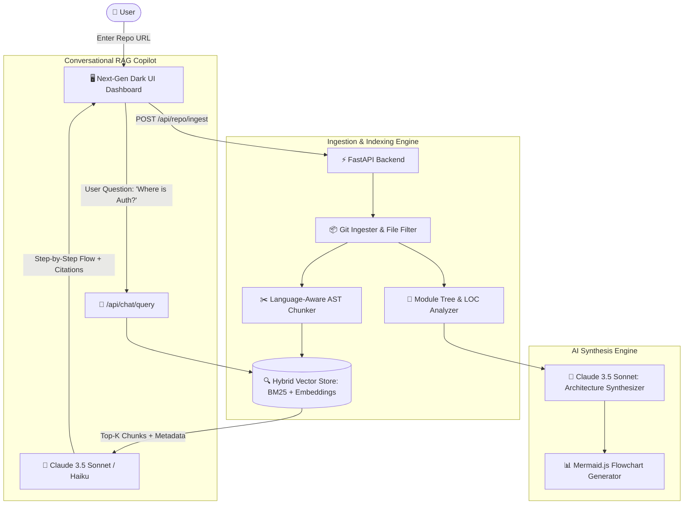

# 🧠 Explain My Codebase

> **AI-Powered GitHub Repository Architecture Visualizer & Interactive Codebase Copilot**  
> Ingest any public GitHub repository (or local project), automatically map its architectural layers (Frontend, Backend, Auth, Database, APIs, Services), render dynamic Mermaid flowcharts, and ask natural language questions with precise file citations.

---

## 🌟 Key Features

- **🚀 1-Click Repository Ingestion**: Clones, sanitizes, and indexes any GitHub repository in seconds using shallow clones (`--depth 1`) and AST-aware file filtering.
- **📂 Semantic Module Categorization**: Automatically groups files into key architectural layers:
  - 🌐 **Frontend UI** (React, Vue, Next.js, Pages, Components, Hooks)
  - ⚙️ **Backend & APIs** (Routers, Controllers, Handlers, Endpoints)
  - 🔐 **Authentication & Security** (JWT, OAuth, Sessions, Middleware, Guards)
  - 🗄️ **Database & Models** (SQLAlchemy, Prisma, Schemas, Migrations)
  - 🧩 **Services & Integrations** (External APIs, Helpers, Workers, Tasks)
  - 🛠️ **Config & DevOps** (Docker, CI/CD, Environment)
- **📊 Dynamic Mermaid.js Flow Diagrams**: Automatically generates and renders interactive sequence and flowchart diagrams visualizing how client requests travel through the codebase.
- **🔎 Hybrid Vector & Lexical RAG Engine**: Combines **Reciprocal Rank Fusion (RRF)** over dense semantic vectors and BM25 token frequencies for pinpoint retrieval across multi-file codebases.
- **🤖 Claude 3.5 Sonnet Copilot**: Ask questions like *"Where does user authentication happen?"* or *"Explain the payment flow"* to receive:
  - Concise architectural summaries
  - Step-by-step control/data flow breakdowns
  - Generated Mermaid flowcharts
  - **Clickable file & line citations** (e.g. `[src/auth/router.py:24-68]`) that jump directly to the built-in syntax-highlighted code viewer.
- **💻 Built-in Code Viewer**: Interactive viewer with line numbers and Prism.js syntax highlighting across 15+ programming languages.

---

## 🏗️ System Architecture



---

## 🛠️ Tech Stack

| Layer | Technology | Purpose |
|---|---|---|
| **Backend API** | **FastAPI (Python 3.10+)** | High performance async REST API endpoints |
| **LLM & Reasoning** | **Claude 3.5 Sonnet (Anthropic API)** | Deep code reasoning, flow tracing, and synthesis |
| **Embeddings & Vector Index** | **Hybrid RRF (BM25 + Dense Vectors / OpenAI)** | Multi-granularity code symbol and semantic retrieval |
| **Frontend UI** | **Tailwind CSS, HTML5, Vanilla JS, Lucide** | Lightweight, high-speed, modern glassmorphic dashboard |
| **Diagram Engine** | **Mermaid.js** | Interactive live sequence and architecture diagrams |
| **Code Highlighting** | **Prism.js** | Multi-language syntax highlighting in code viewer |

---

## ⚡ Quick Start

### 1. Clone & Install Dependencies
```bash
git clone https://github.com/your-username/explain-my-codebase.git
cd explain-my-codebase

# Install python dependencies
pip install -r requirements.txt
```

### 2. Configure Environment Variables (Optional for Claude 3.5)
Copy `.env.example` to `.env`:
```bash
cp .env.example .env
```
Edit `.env` and add your API keys:
```env
ANTHROPIC_API_KEY=sk-ant-api03-...
OPENAI_API_KEY=sk-...
PORT=8000
```
*(Note: The system includes a built-in heuristic reasoning engine so you can immediately explore sample repos even before configuring an API key!)*

### 3. Run the Application
```bash
python run.py
```
Open your browser and navigate to:
```
http://localhost:8000
```

---

## 🎯 How to Use

1. **Paste a GitHub Repository URL** (e.g. `https://github.com/fastapi/fastapi` or pick a preloaded sample like `FastAPI RealWorld`).
2. Click **Analyze** to start the ingestion and indexing pipeline.
3. Explore the **Architecture Explorer Tree** on the left to filter files by architectural module (*Auth, Database, API, Frontend, Services*).
4. View the **Architecture Flow Diagram** in the center tab to see system interactions.
5. In the **AI Copilot** panel on the right, ask questions like:
   - *"Where does user authentication happen?"*
   - *"How is database connection and pooling configured?"*
   - *"Trace the lifecycle of an incoming API request."*
6. Click any **file citation badge** (e.g. `[app/routers/auth.py:12-45]`) to jump straight to that line in the **Code Viewer**!

## 📄 License
MIT License. Open source and free to customize.
