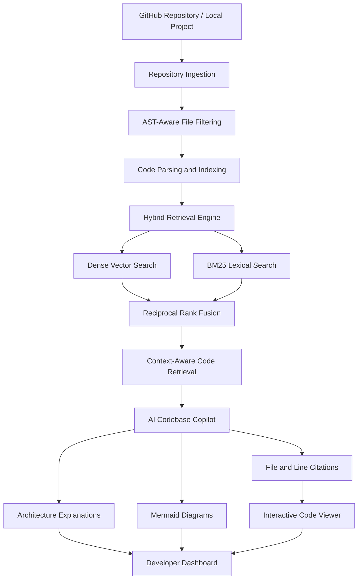

# Explain My Codebase
### AI-Powered GitHub Repository Architecture Visualizer & Interactive Codebase Copilot

**Understand any codebase without getting lost in hundreds of files.**

[Live Demo](https://explain-my-codebase-v7xg.vercel.app/) | [GitHub Repository](https://github.com/Dhitimahajan/Explain-my-Codebase)

Explain My Codebase is an AI-powered repository analysis platform that transforms complex software projects into interactive architectural visualizations. It ingests public GitHub repositories or local projects, identifies architectural components, maps relationships between modules, and enables natural-language exploration through an intelligent codebase copilot.

Instead of manually navigating files and tracing dependencies, developers can explore application architecture, understand request lifecycles, and retrieve context-specific code explanations with precise file and line citations.

---

## Table of Contents

- [Key Features](#key-features)
- [System Architecture](#system-architecture)
- [Tech Stack](#tech-stack)
- [Getting Started](#getting-started)
- [Testing](#testing)
- [Deployment](#deployment)
- [Use Cases](#use-cases)
- [Future Enhancements](#future-enhancements)
- [License](#license)

---

## Key Features

### 1. Intelligent Repository Ingestion

- Supports public GitHub repositories and local project ingestion.
- Uses shallow Git cloning (`--depth 1`) for efficient repository retrieval.
- Applies AST-aware file filtering to identify relevant source files.
- Automatically indexes repository contents for intelligent retrieval.

### 2. Automated Architecture Detection

Automatically categorizes project files into six architectural layers:

| Layer | Components Identified |
|---|---|
| Frontend | Pages, Components, Hooks, UI |
| Backend | Routers, Controllers, Handlers, Endpoints |
| Authentication | JWT, OAuth, Sessions, Middleware |
| Database | Models, Schemas, Migrations, ORM |
| Services | External APIs, Helpers, Workers, Tasks |
| DevOps & Configuration | Docker, CI/CD, Environment Configs |

### 3. Dynamic Architecture Visualization

- Generates interactive Mermaid.js architecture flowcharts.
- Visualizes module relationships and system dependencies.
- Creates sequence diagrams to trace end-to-end request lifecycles.
- Converts complex application structures into understandable visual representations.

### 4. Hybrid Retrieval & RAG Engine

Implements a hybrid retrieval pipeline combining:

- **Dense Vector Search:** Retrieves semantically relevant code snippets.
- **BM25 Lexical Search:** Matches exact keywords, identifiers, and technical terms.
- **Reciprocal Rank Fusion (RRF):** Combines retrieval rankings to improve context selection.

### 5. Interactive Codebase Copilot

Ask natural-language questions about any ingested repository, such as:

- Where does user authentication happen?
- How does an incoming API request reach the database?
- Which services communicate with external APIs?
- What happens when a user submits a form?

The copilot provides:

- Context-aware architectural explanations.
- Step-by-step control and data flow breakdowns.
- Automatically generated Mermaid diagrams.
- Clickable file and line-level citations.

### 6. Interactive Code Viewer

- Syntax highlighting powered by Prism.js.
- Line-numbered source code navigation.
- Support for 15+ programming languages.
- Direct navigation from AI-generated citations to relevant source code.

### 7. Modern Developer Experience

- Warm minimalist interface inspired by modern developer tools.
- Ivory and off-white backgrounds with sage green accents.
- Responsive dashboard and intuitive navigation.
- Clean visual hierarchy and accessible contrast.

---

## System Architecture

The application follows a modular architecture consisting of repository ingestion, source-code processing, hybrid retrieval, AI reasoning, and visualization.



---

## Tech Stack

| Layer | Technology | Purpose |
|---|---|---|
| Backend | Python, FastAPI | Asynchronous REST API and backend processing |
| AI & Reasoning | Claude 3.5 Sonnet, GPT-4o, Local Engine | Code understanding and architectural reasoning |
| Retrieval | BM25, Dense Vector Search, RRF | Hybrid semantic and lexical retrieval |
| Frontend | HTML5, Tailwind CSS, JavaScript | Responsive user interface |
| Visualization | Mermaid.js | Architecture and sequence diagrams |
| Code Viewer | Prism.js | Multi-language syntax highlighting |
| Deployment | Vercel, Render, Docker | Application deployment |

---

## Getting Started

### Prerequisites

- Python 3.10 or higher
- Git
- pip

### 1. Clone the Repository

```bash
git clone https://github.com/Dhitimahajan/Explain-my-Codebase.git
cd Explain-my-Codebase
```

### 2. Create a Virtual Environment

```bash
python -m venv .venv
```

**Windows:**

```bash
.venv\Scripts\activate
```

**macOS / Linux:**

```bash
source .venv/bin/activate
```

### 3. Install Dependencies

```bash
pip install -r requirements.txt
```

### 4. Configure Environment Variables (Optional)

Create a `.env` file using `.env.example` as a reference.

```env
ANTHROPIC_API_KEY=your_anthropic_api_key
OPENAI_API_KEY=your_openai_api_key
PORT=8000
HOST=0.0.0.0
```

External API keys are optional. The application includes a local architectural reasoning engine for exploring repositories without external LLM credentials.

### 5. Run the Application

```bash
python run.py
```

Alternatively, Windows users can launch:

```bash
START_APP.bat
```

Open your browser and visit:

```text
http://localhost:8000
```

---

## Testing

Verify the repository processing pipeline:

```bash
python backend/tests/test_pipeline.py
```

Run the API integration test suite:

```bash
pytest -v backend/tests/test_api.py
```

---

## Deployment

Explain My Codebase supports multiple deployment environments.

### Vercel

The project includes a `pyproject.toml` configuration:

```toml
[tool.vercel]
entrypoint = "backend.app.main:app"
```

Select the repository in Vercel, choose the **Other** framework preset, configure optional API keys, and deploy.

### Render

Use the included `render.yaml` Blueprint configuration to deploy the application.

### Docker

```bash
docker build -t explain-my-codebase .
docker run -p 8000:8000 explain-my-codebase
```

---

## Use Cases

- **New Developers:** Understand unfamiliar repositories and navigate large codebases faster.
- **Software Engineers:** Trace API requests, authentication flows, and database interactions.
- **Students:** Learn real-world software architecture through interactive visualizations.
- **Development Teams:** Accelerate codebase onboarding and architectural exploration.
- **Open-Source Contributors:** Understand project structure before contributing.

---

## Future Enhancements

- Support for private GitHub repositories through secure authentication.
- Dependency graph analysis and cross-module relationship detection.
- More advanced code execution and debugging insights.
- Collaborative codebase exploration.
- Extended language and framework support.

---

## License

This project is licensed under the [MIT License](LICENSE).

---

<p align="center">
  <b>Built to make complex codebases easier to understand.</b>
  <br/>
  Explore. Visualize. Understand.
  <br/><br/>
  <a href="https://explain-my-codebase-v7xg.vercel.app/">Live Demo</a>
  &nbsp; | &nbsp;
  <a href="https://github.com/Dhitimahajan/Explain-my-Codebase">Source Code</a>
</p>
