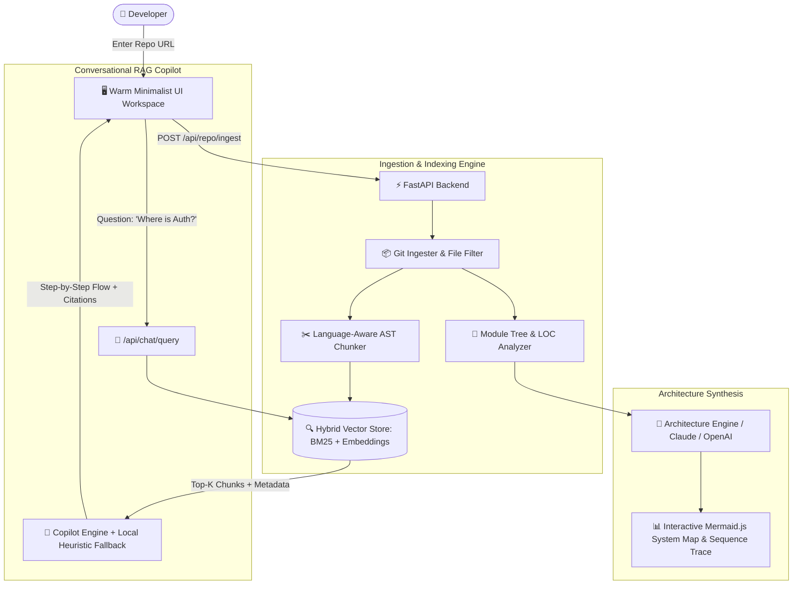

# 🧠 Explain My Codebase

> **AI-Powered GitHub Repository Architecture Visualizer & Interactive Codebase Copilot**  
> Ingest any public GitHub repository (or local project), automatically map its architectural layers (Frontend, Backend, Auth, Database, APIs, Services), render dynamic Mermaid flowcharts, and ask natural language questions with precise file and line citations.

---

## 🌟 Key Features

- **🚀 1-Click Repository Ingestion**: Clones, sanitizes, and indexes any GitHub repository in seconds using shallow clones (`--depth 1`) and AST-aware file filtering.
- **📂 Semantic Module Categorization**: Automatically groups files into key architectural layers:
  - 🌐 **Frontend UI** (React, Vue, Next.js, Pages, Components, Hooks)
  - ⚙️ **Backend & APIs** (Routers, Controllers, Handlers, Endpoints)
  - 🔐 **Authentication & Security** (JWT, OAuth, Sessions, Middleware, Guards)
  - 🗄️ **Database & Models** (SQLAlchemy, Prisma, Schemas, Migrations)
  - 🧩 **Services & Integrations** (External APIs, Helpers, Workers, Tasks)
  - 🛠️ **Config & DevOps** (Docker, CI/CD, Environment)
- **📊 Dynamic Mermaid.js Architecture Diagrams**: Automatically generates and renders interactive **System Map** flowcharts and **Sequence Trace** diagrams visualizing end-to-end request lifecycles.
- **🔎 Hybrid Vector & Lexical RAG Engine**: Combines **Reciprocal Rank Fusion (RRF)** over dense semantic vectors and BM25 token frequencies for sub-millisecond retrieval across multi-file codebases.
- **🤖 Codebase Copilot**: Ask architectural questions like *"Where does user authentication happen?"* or *"Trace an incoming API request to the database"* to receive:
  - Concise architectural summaries
  - Step-by-step control/data flow breakdowns
  - Generated Mermaid flowcharts
  - **Clickable file & line citations** (e.g. `[src/auth/router.py:24-68]`) that jump directly into the built-in syntax-highlighted code viewer.
- **💻 Built-in Code Viewer**: Interactive viewer with line numbers and Prism.js syntax highlighting across 15+ programming languages.
- **🎨 Warm Minimalist Aesthetic**: Thoughtfully designed interface inspired by Replit applications — warm ivory and off-white backgrounds, soft sage green accents, charcoal typography, and accessible contrast.
- **☁️ Multi-Cloud & Vercel Ready**: Configured with `pyproject.toml` for standard Vercel serverless deployment (`[tool.vercel] entrypoint = "backend.app.main"`), Docker, and Render.

---

## 🏗️ System Architecture



---

## 🛠️ Tech Stack

| Layer | Technology | Purpose |
|---|---|---|
| **Backend API** | **FastAPI (Python 3.10+)** | High performance async REST API endpoints |
| **LLM & Reasoning** | **Claude 3.5 Sonnet / GPT-4o / Local Engine** | Code reasoning, flow tracing, and synthesis |
| **Embeddings & Vector Index** | **Hybrid RRF (BM25 + Dense Vectors)** | Instant local semantic and symbol retrieval |
| **Frontend UI** | **Tailwind CSS, HTML5, Vanilla JS, Lucide** | Warm minimalist, responsive dashboard |
| **Diagram Engine** | **Mermaid.js** | Interactive live sequence and architecture diagrams |
| **Code Highlighting** | **Prism.js** | Multi-language syntax highlighting in code viewer |

---

## ⚡ Quick Start

### 1. Clone & Set Up Environment
```bash
git clone https://github.com/Dhitimahajan/Explain-my-Codebase.git
cd Explain-my-Codebase

# Create virtual environment
python -m venv .venv

# Activate on Windows:
.\.venv\Scripts\activate
# Or on macOS/Linux:
source .venv/bin/activate

# Install dependencies
pip install -r requirements.txt
```

### 2. Configure Environment Variables (Optional)
Copy `.env.example` to `.env`:
```bash
cp .env.example .env
```
Edit `.env` if you wish to enable Anthropic Claude or OpenAI GPT-4o:
```env
ANTHROPIC_API_KEY=sk-ant-api03-...
OPENAI_API_KEY=sk-...
PORT=8000
HOST=0.0.0.0
```
*(Note: Explain My Codebase comes with a built-in local architectural reasoning engine so you can immediately explore and analyze repositories even without external API keys!)*

### 3. Run the Application
```bash
python run.py
```
Or double-click `START_APP.bat` on Windows.

Open your browser and navigate to:
```
http://localhost:8000
```

---

## 🧪 Running Automated Tests

Run the pipeline verification test:
```bash
python backend/tests/test_pipeline.py
```

Run the pytest integration test suite:
```bash
pytest -v backend/tests/test_api.py
```

---

## 🚀 Deployment

### Deploying to Vercel
The repository includes a root `pyproject.toml` with the official Vercel FastAPI configuration:
```toml
[tool.vercel]
entrypoint = "backend.app.main"
```

1. Push your repository to GitHub.
2. In the [Vercel Dashboard](https://vercel.com/new), select your `Explain-my-Codebase` repository.
3. Framework Preset: **Other**.
4. In **Environment Variables**, add:
   - `ANTHROPIC_API_KEY` (optional)
   - `OPENAI_API_KEY` (optional)
5. Click **Deploy**. Vercel will automatically discover `backend.app.main:app` and deploy the serverless app.

### Deploying to Render / Docker
- **Render**: `render.yaml` is preconfigured. In Render, select **New > Blueprint** and link this repository.
- **Docker**: Run `docker build -t explain-my-codebase .` and `docker run -p 8000:8000 explain-my-codebase`.

---

## 📄 License
MIT License. Open source and free to customize.
